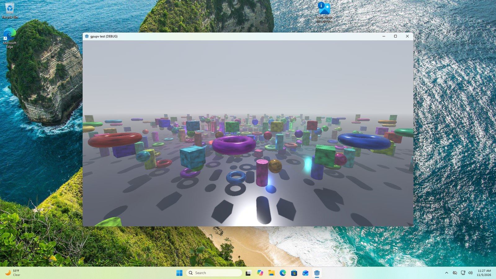
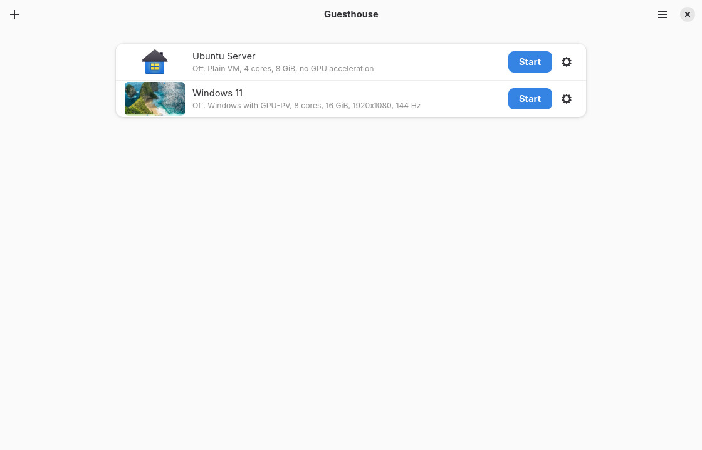
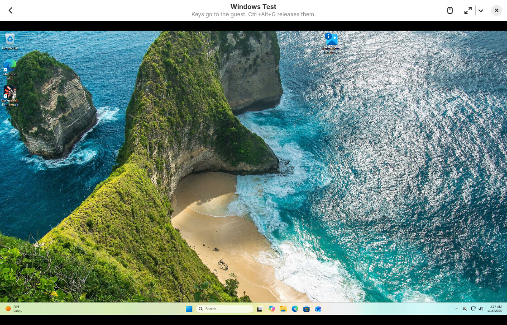
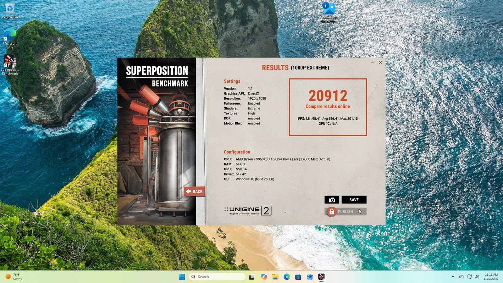
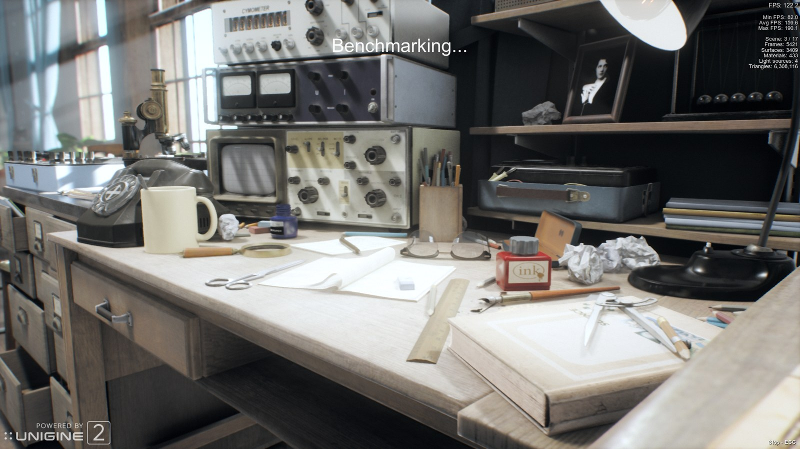
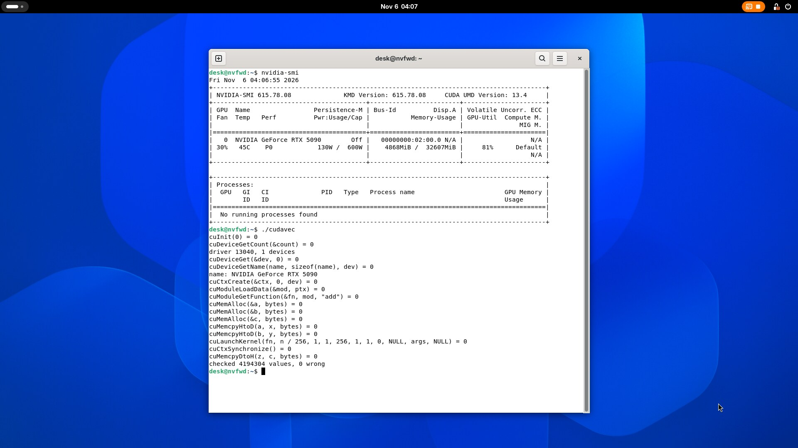
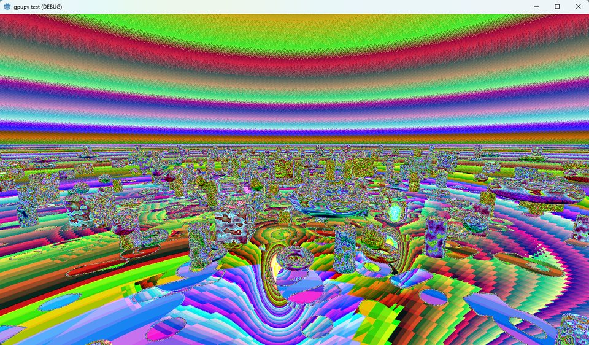

# Guesthouse

**Windows and Linux VMs on KVM that use the same GPU my desktop is using, with NVIDIA's real driver inside.**



That's Godot's full Forward+ renderer on Vulkan, in Windows, in a VM on Fedora. Nothing is passed through. The host never gives up the card, so my GNOME desktop keeps running on it the whole time.

> **Status:** you can't install this yet. The app is here and runs plain VMs. The GPU part only runs on my PC so far, and it isn't in this repo. See [where this is at](#where-this-is-at).

## Why I'm building this

If you want a proper GPU in a Windows VM on Linux, you normally get two options. You pass the whole card through with VFIO and the host loses it, or you buy a datacenter card and a vGPU licence.

Hyper-V has a third way, called GPU-PV. The guest runs the vendor's normal driver and shares the host's card. It's the same plumbing WSL uses. KVM doesn't have it, and I wanted it, because my one big GPU is also the one running my desktop.

So this project teaches KVM to speak Hyper-V's GPU protocol. Windows boots, finds what looks like a Hyper-V GPU, and loads NVIDIA's unmodified driver. After that, the commands the driver writes run directly on the card.

## Where this is at

The GPU backend is still private while I sort out licensing and clean it up. It's been rewritten in Rust too, and it now runs Windows through the new app on my PC, so the Python prototype is on its way out.

This repo is where it's all heading. So far it has:

- the QEMU patch, in `qemu/`
- the code that reads and answers the guest's messages
- the tracking of processes, allocations, fences and GPU addresses
- the line a GPU vendor's backend plugs in at, so AMD and Intel can fit in later
- a tool that replays a recorded session and compares every reply with the prototype's
- the socket that hands frames to a viewer as dmabufs
- the desktop app, in `crates/app`, which runs plain VMs today

There's no GPU backend here yet, so the daemon starts, tells you that, and stops. The app still works: it makes and runs plain VMs, and says why GPU machines aren't there. A plain VM needs QEMU and its D-Bus display, which Fedora calls `qemu-ui-dbus`. The next big step is moving the NVIDIA part over, and after that an installer.





That's the new app. Windows there is on the real GPU, on my PC, with the private backend behind it.

## What the prototype does

Everything here was measured on one machine: Ryzen 9 9950X3D, RTX 5090, Fedora 45, NVIDIA 615.78.08 on the host and 617.42 in Windows.

### Windows guests

Direct3D 12, Direct3D 11, Vulkan and OpenGL all run on the real card, along with the desktop and normal apps. A fresh install takes about 9 minutes from picking the ISO to the GPU working.

**Is it really the GPU, at full speed?** Yes. This is my own benchmark, run on Linux and then inside the VM:

| Test | Linux host | Windows guest |
|---|---|---|
| Compute | 115–119 TFLOPS | 122.6 TFLOPS |
| Video memory copy | 1,064–1,072 GB/s | 1,036 GB/s |
| One dispatch with a barrier | 2.05 µs | 2.05 µs |
| Empty submission round trip | 21 µs | 240 µs |

Once work reaches the card it runs at full speed. Getting it there is what costs extra.

**How fast is a real program?** Superposition at 1080p Extreme in Direct3D 11 scores about **21,000** on a fresh boot, averaging around 157 fps. That's with no viewer open. The lowest 5090 I could find on Unigine's leaderboard is around 31,000, so call it two thirds of what the card can do. Something is still eating the rest, and I don't know what yet.





*Dumps of the guest's real screen, shrunk for this page. The running shot is from an earlier run at the same settings. The result screen says "GPU: NVIDIA" because the launcher can't read the card's name yet, and its RAM line is wrong: the VM had 16 GB.*

A heavy Godot test scene at 1280x720 does about 690 fps natively. In the VM it's about 196 on Vulkan and 158–186 on Direct3D 12. GPU time per frame is the same as native, about 1.2 ms, so that gap isn't the GPU either.

**Is the picture right?** I don't judge that by eye. These tests compare exact values, and the Vulkan and OpenGL ones check the final screen pixel by pixel:

| Test | Wrong |
|---|---|
| Direct3D 12 frames | 0 of 300 |
| Vulkan through a real swapchain | 0 of 256,000 pixels |
| OpenGL through a real window | 0 of 256,000 pixels |

### Linux guests

Linux takes a different route. The guest runs NVIDIA's real Linux driver and its calls get forwarded to the host's driver. So far that's Ubuntu 26.04.1.

`nvidia-smi`, CUDA and Vulkan work, and speed is about the same as the host: 111–113 TFLOPS on Vulkan in both, and a CUDA launch takes 14.5 µs against 13.9. GNOME runs on it through Zink, with Firefox, Files, Settings and a terminal all working. Godot's Windows build even runs in there through Wine on Wayland.



That's `nvidia-smi` and a small CUDA test of mine, on the guest's own desktop. The load and memory it shows are for the whole card, because other VMs were using it at the time.

In theory this route isn't tied to the 5090 the way the Windows one is. It forwards the real driver's calls, so it should work on anything NVIDIA's open driver supports, from the 20 series up, as long as its tables get rebuilt for that driver version. That's only theory for now: it has run on my 5090, on driver 615.78.08, with an AMD CPU, and nothing else.

Delay is where it's behind. A simple app takes about 20 to 30 ms from key press to picture, against about 11.5 on the host, and Godot takes 50 to 100 ms.

## How it works

```
Windows guest                              Linux host
┌──────────────────────────┐               ┌──────────────────────────────┐
│ your app                 │               │ a daemon, playing the part   │
│ NVIDIA's Windows driver  │               │ of Hyper-V                   │
│ dxgkrnl (GPU-PV client)  │ ── VMBus ──▶  │ NVIDIA's Linux driver        │
└──────────────────────────┘    (QEMU)     │ RTX 5090                     │
                                           └──────────────────────────────┘
```

There are three pieces:

- **A QEMU patch**, about 600 lines of code, which gives the guest the devices and the VMBus channels it expects to find on Hyper-V.
- **A daemon**, which answers everything Windows asks, sets up real GPU channels through the Linux driver, and rings their doorbells when the guest has work.
- **A desktop app**, Guesthouse, so that none of this needs a terminal. The prototype's app took a Windows ISO, installed Windows unattended and brought up the GPU. The Rust one has that code too, but I haven't proven it yet. From this repo alone it runs plain VMs.

Apart from one small workaround, the guest's commands aren't translated. The Windows driver writes them, and the GPU runs them. Finished frames stay in video memory and reach the viewer as dmabufs.

## Keeping guests apart

A VM is only worth having if what's in it stays in it, so here's where that stands.

What's in place for Windows guests:

- **Programs in a VM can't see each other on the GPU.** Each process gets its own GPU page tables, like on real Windows. My test has one process hold a secret and another try to read it by its GPU address. With one shared space it read all 16,384 words. Now it reads none. The one thing they still share is a block of fences, which only holds counters.
- **Windows never talks to the host's driver.** It talks to my daemon, and the daemon makes the calls. Sizes and ranges in every message get checked, and the parsers and handlers are fuzz tested.
- **You can cap a VM's video memory.** With a limit set, anything over it gets refused. Without one, the VM is told to leave a share of the card for the host, but that's a budget and not a wall.
- **The daemon's sockets are for its owner alone.**

What's still coming:

- **Jails.** The daemon and QEMU run as you, with nothing around them. That's the next wall to build.
- **Linux guests aren't walled off yet.** Their driver calls get forwarded to the host, so for now treat a Linux guest like your own user account, and don't run anything in it you wouldn't run on your host. I'm fixing that now with stricter checks on every forwarded call, limits on calls and video memory, and then a proper jail around the part that talks to the driver. This route won't go public until the checks are in.

## My favourite bugs

**"The window is occluded."** Every Vulkan present failed with `PRESENT_OCCLUDED` while the window sat there in plain sight. I spent hours in Windows' visibility code. The real cause was my own daemon: Windows was sending it a copy to do, and it was refusing with "not surfaces I know". That line had been in my own log the whole time.

**1,366 allocations.** Vulkan fell over at 4K. The driver wanted a 256 MiB block in 32 MiB pieces, and my daemon kept answering "here's 192 KiB", so as far as I can tell the driver politely asked again, about 1,366 times per block. Answering with what it asked for took one run from 8,129 allocations to 374, and 4K started working.

**The blank Explorer.** WinUI apps opened with empty windows. Their frames were waiting on a CPU event that nobody ever signalled.

**The psychedelic sky.** Geometry perfect, colours from another dimension. A 10-bit image was being copied byte for byte into an 8-bit surface.



## What doesn't work yet

I'd rather you hear this from me:

- **You can't install it.** See above.
- **It has only ever run on my PC, on an RTX 5090.** A clean clone does set itself up and pass its tests now, but that's still my machine and my card.
- **Drivers are tied together.** Linux and Windows have to come from the same NVIDIA branch, and a new branch means new work.
- **CUDA, NVENC and NVDEC don't work in Windows yet.** `nvidia-smi` can't open the card there either, and Task Manager doesn't show the GPU.
- **No HDR in the app yet.** It's a must for me. The new display driver isn't in the app, but in tests it gets every frame to the host at up to 4K 240 Hz, in SDR and HDR, with none lost. That's a simple test picture reaching a test client, so a real game and a real viewer still have to prove it.
- **The viewer drops frames.** With the old viewer, at 144 Hz about 116 frames a second reached it, and about 90 at 4K. I haven't measured the new one yet. It also costs speed: Superposition scored 16,240 with it open.
- **Several GPU VMs at once is early.** Three Windows VMs have run together on one card with their tests passing and no GPU faults, but that was during my testing, not a proper test of its own. I haven't tried it through the app, and they share the card's speed.

## What's next

The full list, with what's already done, is in the [roadmap](https://github.com/xnixy/guesthouse/issues/2). The short version:

1. Move the NVIDIA backend here, so this repo can boot a guest
2. An installer, so you can try it
3. The new display driver, for real refresh rates and HDR
4. CUDA and video in Windows
5. Find the missing third of the speed
6. Lock down Linux guests, and put jails around the daemon and QEMU
7. Several GPU VMs at once through the app, tested properly

## Trying the code

You need a recent stable Rust, and no GPU or VM.

```sh
cargo test                       # everything
cargo bench -p guesthouse-core   # the message path, in nanoseconds
cargo run -p guesthouse-app       # the app, which needs GTK 4 and libadwaita's development files
```

[ARCHITECTURE.md](ARCHITECTURE.md) explains how the pieces fit, and [CONTRIBUTING.md](CONTRIBUTING.md) how to work on them.

## Bring your own

This repo has no NVIDIA or Microsoft files in it. You supply your own Windows ISO and NVIDIA's driver. This is a personal project, and it has nothing to do with NVIDIA or Microsoft.

## Thanks

None of this would exist without other people's work:

- QEMU, which this is a patch for
- Microsoft's dxgkrnl driver for Linux, the public source for how GPU-PV talks
- NVIDIA's open GPU kernel modules
- gVisor's nvproxy, the closest thing to the Linux route I've seen
- Mesa's Zink, which GNOME runs on in Linux guests
- GTK, libadwaita and the Rust crates the app is built on

## Licence

Copyright (C) 2026 xnixy

GPL-2.0-or-later, the QEMU patch included. See [LICENSE](LICENSE). A few things in here come from elsewhere, and [THIRD-PARTY.md](THIRD-PARTY.md) lists them.

NVIDIA, GeForce and Windows are trademarks of their owners.
