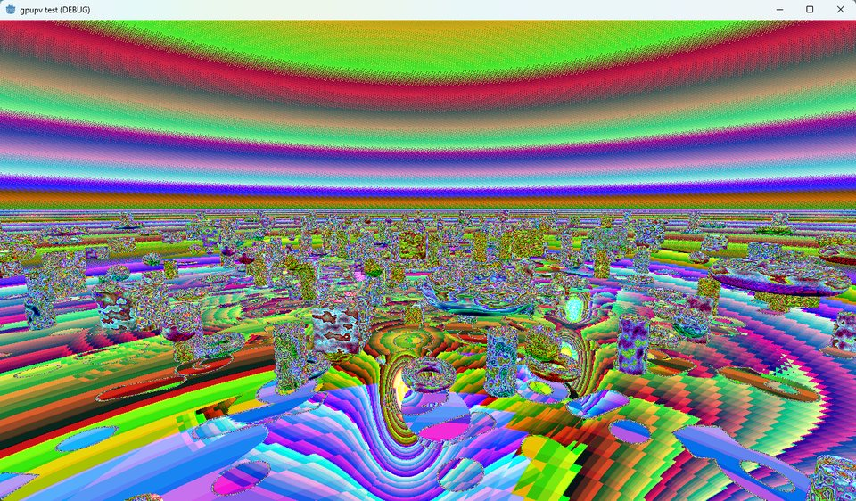

# My favourite bugs

**"The window is occluded."** Every Vulkan present failed with `PRESENT_OCCLUDED` while the window sat there in plain sight. I spent hours in Windows' visibility code. The real cause was my own daemon: Windows was sending it a copy to do, and it was refusing with "not surfaces I know". That line had been in my own log the whole time.

**1,366 allocations.** Vulkan fell over at 4K. The driver wanted a 256 MiB block in 32 MiB pieces, and my daemon kept answering "here's 192 KiB", so as far as I can tell the driver politely asked again, about 1,366 times per block. Answering with what it asked for took one run from 8,129 allocations to 374, and 4K started working.

**The blank Explorer.** WinUI apps opened with empty windows. Their frames were waiting on a CPU event that nobody ever signalled.

**The psychedelic sky.** Geometry perfect, colours from another dimension. A 10-bit image was being copied byte for byte into an 8-bit surface.

